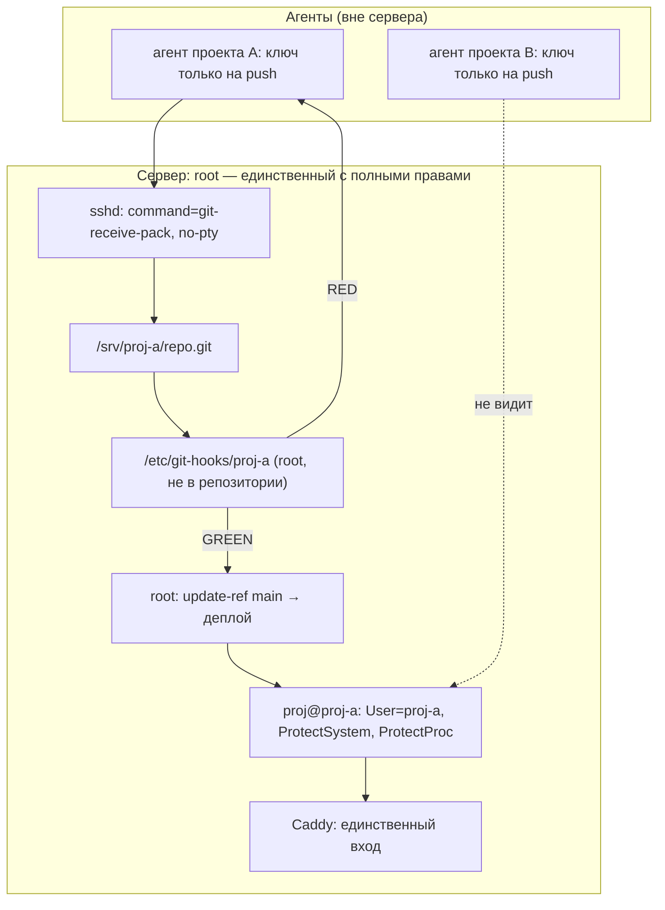

# Изоляция проектов и агентов

Версия 0.9.8 · 22.10.2026

Один хост — несколько проектов — несколько агентов. Root — единственный,
у кого полные права. Агент проекта получает только git-push в `review`.

## Модель

- Каждый проект — отдельный пользователь `proj-*`, каталог `/srv/proj-*`,
  bare-репозиторий `/srv/proj-*/repo.git`.
- Агент ходит по SSH с ключом, у которого forced command:
  `git-receive-pack '/srv/proj-*/repo.git'`, без pty, forwarding и X11.
- Хуки лежат в `/etc/git-hooks/<proj>` (root:root, 0755), не в репозитории.
- Агент пушит только в `refs/heads/review`. В `main` двигает только root
  через `git update-ref` — это акт одобрения.
- После зелёного `review` root делает merge в `main` и перезапускает
  `proj@<proj>.service`. У агента нет sudo и нет shell.

## Матрица прав

| Действие | Агент проекта | Root |
| --- | --- | --- |
| Читать свой код | да | да |
| Читать чужой проект | **нет** | да |
| Писать в свой каталог | да | да |
| Писать в `/etc`, юниты, хуки | **нет** | да |
| Пушить в `review` | да | да |
| Пушить в `main` | **нет** | да |
| Деплоить и перезапускать | **нет** | да |
| Секреты своего проекта | да | да |
| Секреты чужого проекта | **нет** | да |
| Порты наружу | **нет** | да |

## Схема



## Раскладка

```text
/srv                         0711 root:root
/srv/proj-a                  0750 proj-a:proj-a
/srv/proj-a/repo.git         bare, proj-a
/srv/proj-a/CANARY           0640 proj-a:proj-a
/etc/git-hooks/proj-a        0755 root:root
/etc/proj-a/                 0750 root:proj-a
/etc/proj-a/*.env            0640 root:proj-a
/etc/systemd/system/proj@.service
```

## Ключ агента

```text
command="git-receive-pack '/srv/proj-a/repo.git'",no-pty,no-port-forwarding,no-agent-forwarding,no-X11-forwarding ssh-ed25519 AAAA... agent-a
```

`authorized_keys` — `0600 proj-a:proj-a`. Ключ не даёт shell, scp, rsync,
port forwarding или запуск произвольной команды.

## Юнит

`deploy/systemd/proj@.service` — шаблон. Экземпляр `proj@proj-a`:

```ini
User=%i
ProtectSystem=strict
ProtectHome=yes
ProtectProc=invisible
PrivateTmp=yes
NoNewPrivileges=yes
MemoryMax=512M
CPUQuota=50%
TasksMax=64
```

`ReadWritePaths=/srv/%i`; секреты — `EnvironmentFile=-/etc/%i/app.env`.

## Онбординг

```bash
sudo deploy/bootstrap-project.sh proj-a
# положить публичный ключ агента:
sudo AGENT_PUBKEY="ssh-ed25519 AAAA... agent-a" deploy/bootstrap-project.sh proj-a
# проверить изоляцию:
sudo deploy/selftest-isolation.sh proj-a proj-b
```

## Проверки

- `python verify.py` — green.
- `python verify.py --close-task` — green.
- `sudo deploy/selftest-isolation.sh proj-a proj-b`:
  - `proj-a` не читает `CANARY` проекта B;
  - `proj-a` не имеет sudo;
  - нет внешних портов;
  - hooksPath и права root:root;
  - unit существует.
- Живой push:
  - `git push origin HEAD:main` → rejected;
  - `git push origin HEAD:review` → accepted после verify;
  - удаление/force push → rejected.

## Границы

- Это Linux/systemd/sshd-модель; на Windows live-проверка невозможна.
- Caddy — единственный вход; порты приложений наружу не публикуются.
- Секреты своего проекта доступны агенту только через запущенный процесс
  или явно выданный env; в репозитории секретов нет.
- Нового правила нет: политика живёт в `PROJECT.md`, этом файле и
  `PROCESS.md`.
