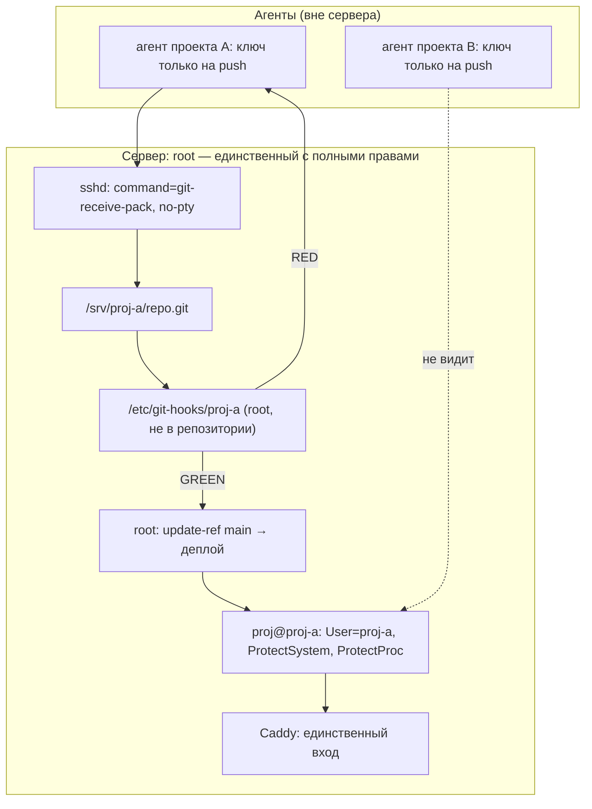

# Изоляция проектов и агентов

Версия 0.9.14 · 22.10.2026

Один хост — несколько проектов — несколько агентов. Root — единственный,
у кого полные права. Агент проекта получает только git-push в `review`.

## Имена и реестр

`id` — полный токен проекта, например `proj-a`. Он один раз задаёт все
артефакты; второй префикс не добавляется.

```text
^[a-z][a-z0-9-]{2,19}$
```

Без `--`, без дефиса в конце, 3–20 символов. Кириллица и `_` запрещены.
Зарезервированы: `root`, `app`, `caddy`, `watchdog`, `admin`, `system`,
`debian`, `ubuntu`, `nobody`, `daemon`, `bin`, `sys`, `mail`, `www`,
`git`, `ssh`.

| Артефакт | Из `id` |
| --- | --- |
| Unix-пользователь | `<id>` |
| Каталог | `/srv/<id>` |
| Репозиторий | `/srv/<id>/repo.git` |
| Хуки | `/etc/git-hooks/<id>` |
| Секреты | `/etc/<id>/*.env` |
| Юнит | `proj@<id>.service` |
| Лог приёмки | `/var/log/git/<id>.log` |
| Поддомен | `<id>.<BASE_DOMAIN>` |

Два поля: `id` — пути/юниты/домены, неизменяем; `display` — сообщения и
документация, 1–64 символа, никогда не становится путём.

## Реестр

- `projects.example.json` — коммитится, только `proj-a` и `proj-b`.
- `projects.json` — рабочий реестр хоста, в `.gitignore`, не в публичном
  репозитории.
- Поля проекта: `display`, `agent`, `domain`, `port`, `status`;
  лишние поля — ошибка.
- `domain` пустой или валидный поддомен; уникален.
- `port` 0 или 1024–65535; уникален среди ненулевых.
- `status`: `active`, `paused`, `planned`.

## Модель

- Каждый проект — отдельный пользователь `proj-*`, каталог `/srv/proj-*`,
  bare-репозиторий `/srv/proj-*/repo.git`.
- Агент ходит по SSH с ключом, у которого forced command:
  `git-receive-pack '/srv/proj-*/repo.git'`, без pty, forwarding и X11.
- Хуки лежат в `/etc/git-hooks/<proj>` (root:root, 0755), не в репозитории.
- Агент пушит только в `refs/heads/review`. В `main` двигает только root
  через `git update-ref` — это акт одобрения.
- После зелёного `review` root делает merge в `main` и перезапускает
  `proj@<proj>.service`. У агента нет sudo и нет shell.

## Матрица прав

| Действие | Агент проекта | Root |
| --- | --- | --- |
| Читать свой код | да | да |
| Читать чужой проект | **нет** | да |
| Писать в свой каталог | да | да |
| Писать в `/etc`, юниты, хуки | **нет** | да |
| Пушить в `review` | да | да |
| Пушить в `main` | **нет** | да |
| Деплоить и перезапускать | **нет** | да |
| Секреты своего проекта | да | да |
| Секреты чужого проекта | **нет** | да |
| Порты наружу | **нет** | да |

## Схема



## Раскладка

```text
/srv                         0711 root:root
/srv/proj-a                  0750 proj-a:proj-a
/srv/proj-a/repo.git         bare, proj-a
/srv/proj-a/CANARY           0640 proj-a:proj-a
/etc/git-hooks/proj-a        0755 root:root
/etc/proj-a/                 0750 root:proj-a
/etc/proj-a/*.env            0640 root:proj-a
/etc/systemd/system/proj@.service
```

## Ключ агента

```text
command="git-receive-pack '/srv/proj-a/repo.git'",no-pty,no-port-forwarding,no-agent-forwarding,no-X11-forwarding ssh-ed25519 AAAA... agent-a
```

`authorized_keys` — `0600 proj-a:proj-a`. Ключ не даёт shell, scp, rsync,
port forwarding или запуск произвольной команды.

## Юнит

`deploy/systemd/proj@.service` — шаблон. Экземпляр `proj@proj-a`:

```ini
User=%i
ProtectSystem=strict
ProtectHome=yes
ProtectProc=invisible
PrivateTmp=yes
NoNewPrivileges=yes
MemoryMax=512M
CPUQuota=50%
TasksMax=64
```

`ReadWritePaths=/srv/%i`; секреты — `EnvironmentFile=-/etc/%i/app.env`.

## Онбординг

```bash
sudo deploy/bootstrap-project.sh proj-a
# bootstrap сам создаёт main из SOURCE_REPO (по умолчанию — этот шаблон)
sudo AGENT_PUBKEY="ssh-ed25519 AAAA... agent-a" deploy/bootstrap-project.sh proj-a
# рабочий реестр — вне git:
cp projects.example.json projects.json
# проверить изоляцию:
sudo REGISTRY=projects.json deploy/selftest-isolation.sh proj-a proj-b
```

`SOURCE_REPO`/`SOURCE_REF` переопределяют источник initial main, если
проект сеется не из шаблона. Пока `refs/heads/main` нет, `pre-receive`
отклоняет `review`: доверенный `verify.py` берётся именно из main.

## Доверенный gate

`pre-receive` не запускает `verify.py` из пушимого дерева. Он берёт
`verify.py` из `refs/heads/main` и запускает его на pushed tree. Изменения
`verify.py`, `project.json`, `tests/`, `cmd/schemes` и `cmd/deadcode`
отклоняются до запуска. Так агент не может ослабить проверку тем же пушем.

## PATH и Go

sshd не добавляет `/usr/local/go/bin` в `PATH`. Хук явно выставляет:

```bash
PATH="/usr/local/go/bin:/usr/bin:/bin${PATH:+:$PATH}"
```

Без этого `go test`, `gofmt`, `deadcode` уходили бы в skip.

## Пользователь без shell

`useradd --shell "$(command -v git-shell)"`; существующему пользователю
`usermod --shell ...`. `git-shell` пропускает только git-команды, поэтому
forced command работает, а интерактивного shell нет. Проверка:
`getent passwd proj-a` → `git-shell`; `ssh ... id` не выполняет `id`.

## Журнал приёмки

`/var/log/git/<proj>.log` — root:<proj>, 0640; hook пишет строку на каждый
push: дата, ref, old, new, результат, причина. Запись идёт через ACL
(`setfacl -m u:<proj>:rw-`), иначе bootstrap падает в 0660 и предупреждает.
Ротация — `/etc/logrotate.d/proj-<proj>`: `size 100k`, `rotate 5`,
`copytruncate`; ACL сохраняется.

## Один проект

`selftest-isolation.sh` работает и с одним проектом:

```bash
sudo deploy/selftest-isolation.sh proj-a
```

Проверяет: свой CANARY читается, sudo нет, портов нет, hooks/unit/log
на месте. С двумя — плюс «чужой CANARY не читается».

## systemd

`ExecStart=/srv/%i/run` — стек-нейтральный launcher. `systemd-analyze verify`
на шаблоне без `run` ожидаемо краснеет; проверять юнит нужно на живом
экземпляре. `run` должен быть исполняемым и запускать приложение проекта.

## Предупреждение про /srv

`bootstrap-project.sh` ставит `/srv` в `0711`. Это влияет на **весь хост**,
не только на новый проект. Если на `/srv` есть другие данные — проверь
владельца и режим до онбординга.

## Проверки

- `python verify.py` — green.
- `python verify.py --close-task` — green.
- `sudo deploy/selftest-isolation.sh proj-a proj-b`:
  - `proj-a` не читает `CANARY` проекта B;
  - `proj-a` не имеет sudo;
  - нет слушающих сокетов;
  - hooksPath и права root:root;
  - unit и log на месте.
- Живой push:
  - `git push origin HEAD:main` → rejected;
  - `git push origin HEAD:review` → accepted после trusted verify;
  - подмена `verify.py` в review → rejected;
  - удаление/force push → rejected.
- `deploy/audit-drift.sh projects.json` — сироты в обе стороны:
  каталог без записи и запись без каталога.
- `selftest-isolation.sh` принимает только id из `projects.json`.

## Канал команд

Задачи приходят из приватного `all-project-base-findings` (автор
`conductor`, метка `from:conductor`), а не из публичного трекера шаблона.
Публичная история закрытых команд — `docs/acceptance/`; формат и фильтр
утечек — [docs/acceptance/README.md](acceptance/README.md).
Агент **только читает** issues и комментарии, в доску не пишет вообще;
отчёт — файл `docs/acceptance/` и сообщение коммита `(findings#N)`,
отказ — файл с первой строкой `Отказ: <причина>`. Issue закрывает только
`conductor`.

## CI isolation

`.github/workflows/isolation.yml` запускает `deploy/ci/isolation.sh` на
`ubuntu-latest`: bootstrap двух проектов, `git-shell`, seed `main`,
review/force/delete, подмена `verify.py`, canary, sudo, hooksPath, лог и
logrotate. В конце — `deploy/ci/isolation-cleanup.sh`. Джоба краснеет при
возврате `nologin`, отсутствии `main` или ослаблении gate.

## Границы

- Это Linux/systemd/sshd-модель; на Windows live-проверка невозможна.
- Caddy — единственный вход; порты приложений наружу не публикуются.
- Секреты своего проекта доступны агенту только через запущенный процесс
  или явно выданный env; в репозитории секретов нет.
- Нового правила нет: политика живёт в `PROJECT.md`, этом файле и
  `PROCESS.md`.
